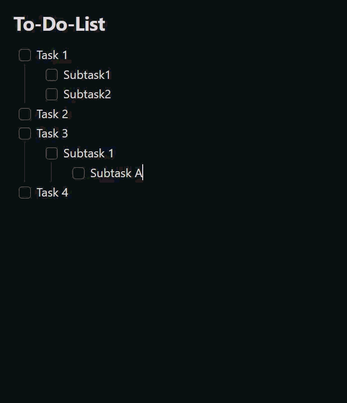

# Smart Done Mover

Ein [Obsidian](https://obsidian.md)-Plugin, das erledigte Checkbox-Aufgaben –
inklusive ihrer eingerückten Unteraufgaben – in einen frei konfigurierbaren
Done-Abschnitt derselben Notiz verschiebt.

🌍 **Sprachen:** [English](README.md) · Deutsch (diese Seite) · [简体中文](README.zh-CN.md)
Die Plugin-Oberfläche richtet sich nach der Obsidian-Sprache: standardmäßig
Englisch, Deutsch wenn Obsidian auf Deutsch eingestellt ist, und
vereinfachtes Chinesisch wenn Obsidian auf Chinesisch eingestellt ist.

## Demo



## Funktionen

- **Rechtsklick-Menü** im Editor:
  - *Erledigte Aufgaben nach Done verschieben* — verschiebt alle vollständig
    erledigten Aufgaben.
  - *Auswahl nach Done verschieben* — verschiebt die Aufgaben-Blöcke, die von
    der aktuellen Textauswahl berührt werden (erscheint nur bei aktiver
    Auswahl).
- Dieselben Aktionen gibt es als **Befehle** (Befehlspalette,
  hotkey-fähig).
- **Auto-Modus** (optional): Sobald eine Aufgabe abgehakt wird, wandert sie
  automatisch nach Done. Auch über das
  [Tasks](https://publish.obsidian.md/tasks/)-Plugin in die Quellnotiz
  zurückgeschriebene Abschlüsse werden nach einer kurzen Verzögerung
  (mindestens etwa 400 ms) erkannt.
- **Aufgaben wieder öffnen**: Erfüllt ein Block im Erledigt-Abschnitt die
  Abschlussbedingungen nicht mehr, verschiebt ihn der Auto-Modus zurück.
  Das Erstellungsdatum `➕ YYYY-MM-DD` der obersten Aufgabe bestimmt die
  Tagesnotiz. Der Block wird unter der eingestellten Überschrift zum
  Wiederherstellen angehängt. Die Vorgabe `# 新增代办` erkennt auch `# 新增待办`.
  Fehlt das Datum, die Tagesnotiz oder die Überschrift, bleibt der Block im
  Erledigt-Abschnitt.
- **Aufgabenfilter** (optional): Verschiebt nur Aufgaben, die einen Textfilter
  wie `#task` enthalten. Der Filter gilt für Auto-Modus, **Erledigte Aufgaben
  nach Done verschieben** und **Auswahl nach Done verschieben**.
  - Ein leerer Filter erhält das ursprüngliche Verhalten: Alle vollständig
    erledigten Aufgabenblöcke können verschoben werden.
  - Eine passende Aufgabe muss abgehakt sein. Hat sie passende Nachfahren,
    müssen auch diese abgehakt sein; ungefilterte Nachfahren blockieren nicht.
  - Eine passende Elternaufgabe verschiebt ihren vollständigen eingerückten
    Block einschließlich Notizen und ungefilterter Checkboxen. Eine passende
    Unteraufgabe unter einer ungefilterten Elternaufgabe wird mit ihrem eigenen
    eingerückten Block selbstständig verschoben.
- **Ausgeschlossene Ordner/Dateien** (optional): In den konfigurierten
  Vault-Pfaden (inklusive Unterordnern) bleibt der Auto-Modus inaktiv;
  manuelle Befehle funktionieren dort weiterhin.
- Unteraufgaben wandern als Block mit; die Einrückung bleibt erhalten.
- Optional wird an jede verschobene, abgehakte Zeile ein Erledigt-Datum
  `✅ JJJJ-MM-TT` angehängt (keine doppelten Datumsangaben).
- Ein einfacher Überschriftsname erhält das bisherige Verhalten mit
  `### Done`; eine vollständige Markdown-Überschrift wie `# Erledigt` wählt
  deren Ebene. Eine vorhandene Überschrift mit demselben Titel wird verwendet.

## Einstellungen

| Einstellung | Beschreibung | Standard |
|-------------|--------------|----------|
| Auto-Modus | Erledigte Aufgaben automatisch verschieben | aus |
| Done-Überschrift | Zielüberschrift. Klartext erzeugt `###`; Markdown behält die Ebene. | `Done` |
| Überschrift zum Wiederherstellen | Vorhandene Überschrift in der Tagesnotiz. Ein Name oder eine Markdown-Überschrift ist möglich. | `# 新增代办` |
| Aufgabenfilter | Text, den eine Aufgabe vor dem Verschieben enthalten muss; leer deaktiviert den Filter. | leer |
| Erledigt-Datum anhängen | `✅`-Datum an verschobene Zeilen anhängen | an |
| Ausgeschlossene Ordner/Dateien | Vault-Pfade (einer pro Zeile), in denen der Auto-Modus inaktiv bleibt | leer |

## Nutzung

1. Eine Notiz mit einer Checkbox-To-Do-Liste öffnen.
2. Den optionalen **Aufgabenfilter** einrichten, wenn nur markierte Aufgaben
   wie `#task` verschoben werden sollen.
3. Im Editor rechtsklicken und eine Aktion wählen, den passenden Befehl über
   die Befehlspalette ausführen oder **Auto-Modus** einschalten.
4. Erledigte Aufgaben wandern unter die konfigurierte Done-Überschrift.

## Offenlegung

- Das Plugin arbeitet vollständig offline und stellt **keine
  Netzwerkanfragen**.
- Es sammelt **keine Telemetrie** und speichert keine Daten außerhalb des
  Vaults.
- Beim Archivieren wird die aktuelle Notiz geändert. Beim automatischen
  Wiederöffnen kann auch die Tagesnotiz des Erstellungsdatums geändert werden.
- Die Einstellungen liegen in der `data.json` des Plugins im
  Konfigurationsordner des Vaults.
- Kein Konto, keine Zahlung, kein externer Dienst erforderlich.

## Aus dem Quellcode bauen

```bash
npm ci
npm test          # Unit-Tests (Vitest)
npm run build     # erzeugt main.js
```

## Installation in einen Vault

Für eine normale Installation `main.js` und `manifest.json` aus dem passenden
GitHub-Release herunterladen und nach
`<Vault>/.obsidian/plugins/smart-done-mover/` kopieren und das Plugin unter
*Einstellungen → Community-Plugins* aktivieren.

Für die Entwicklung kann der Projektordner auch direkt als Plugin-Ordner
verwendet werden (`npm run dev` für einen Watch-Build).

## Releases

Ein gepushter Git-Tag löst den GitHub-Actions-Workflow in
`.github/workflows/release.yml` aus, der das Plugin baut und `main.js` sowie
`manifest.json` an ein neues GitHub-Release anhängt. Der Tag muss zur
`version` in der `manifest.json` passen.

## Projektaufbau

| Datei | Zweck |
|-------|-------|
| `main.ts` | Plugin-Klasse: Befehle, Kontextmenü, Auto-Modus |
| `src/taskParser.ts` | Markdown-Parsing, Abschnitts- und Block-Erkennung |
| `src/mover.ts` | Reine Verschiebe-Logik (`moveCompletedTasks`, `moveSelectedTasks`) |
| `src/settings.ts` | Einstellungs-Oberfläche |
| `src/exclusions.ts` | Pfad-Ausschluss-Logik für den Auto-Modus |
| `src/i18n.ts` | Lokalisierung der UI-Texte (Englisch / Deutsch / vereinfachtes Chinesisch) |
| `src/types.ts` | Gemeinsame Typen und Standardwerte |
| `src/*.test.ts` | Unit-Tests |

`taskParser.ts`, `mover.ts` und `exclusions.ts` enthalten keine
Obsidian-Abhängigkeiten und sind dadurch ohne laufendes Obsidian testbar.

## Ursprung

Smart Done Mover ist ein unabhängiges Projekt auf Basis von
[To-Do to Done Mover](https://github.com/DonnervS/obsidian-todo-done-mover)
von DonnervS. Die ursprüngliche MIT-Lizenz bleibt erhalten.

## Lizenz

[MIT](LICENSE)
