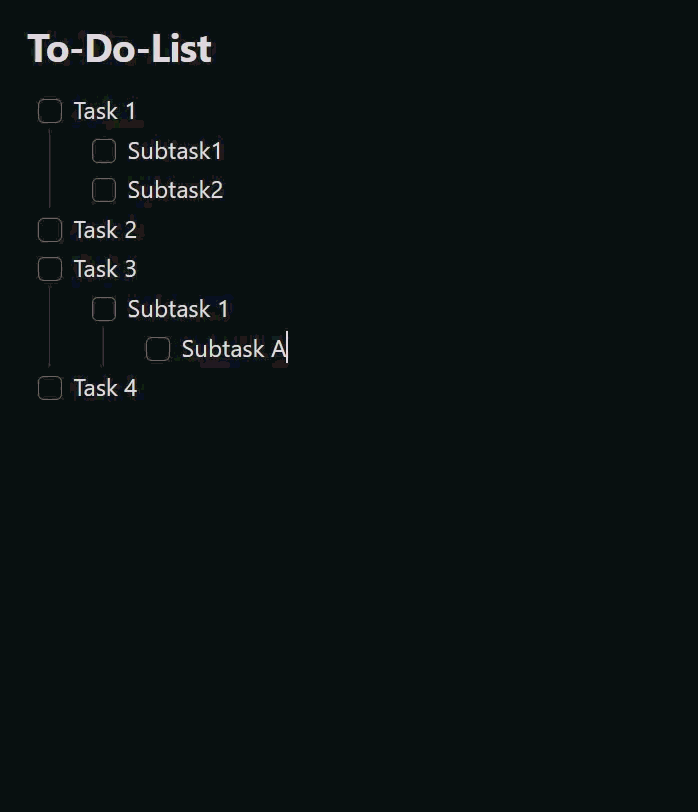

# Smart Done Mover

An [Obsidian](https://obsidian.md) plugin that moves completed checkbox tasks
— including their indented sub-tasks — into a customizable Done section of the
same note.

🌍 **Languages:** English (this page) · [Deutsch](README.de.md) · [简体中文](README.zh-CN.md)
The plugin interface follows Obsidian's UI language: English by default,
German when Obsidian is set to German, and Simplified Chinese when Obsidian is
set to Chinese.

## Demo



## Features

- **Right-click menu** in the editor:
  - *Move completed tasks to Done* — moves every fully completed task.
  - *Move selection to Done* — moves the task blocks touched by the current
    text selection (only shown when text is selected).
- The same actions are available as **commands** (command palette, can be
  bound to hotkeys).
- **Auto mode** (optional): as soon as a task is checked, it moves to Done
  automatically. It also detects task completions written back to source notes
  by the [Tasks](https://publish.obsidian.md/tasks/) plugin after a short
  debounce (about 400 ms or more).
- **Task filter** (optional): move only tasks matching a text filter such as
  `#task`. The filter applies to auto mode, **Move completed tasks to Done**,
  and **Move selection to Done**.
  - Leave the filter empty to keep the original behavior: all fully completed
    task blocks can move.
  - A matching task must be checked. If it has matching descendants, they must
    be checked too; non-matching descendants do not block the move.
  - A matching parent moves its complete indented block, including notes and
    non-matching child checkboxes. A matching child under a non-matching parent
    moves independently with its own indented block.
- **Excluded folders/files** (optional): auto mode stays inactive in the
  configured vault paths (including subfolders); manual commands still work
  there.
- Sub-tasks move along with their parent; indentation is preserved.
- Optionally appends a completion date `✅ YYYY-MM-DD` to each moved, checked
  line (no duplicate dates).
- Use a plain Done heading name for the original `### Done` behavior, or enter
  a full Markdown heading such as `# Completed` to choose its level. An
  existing heading with the same title is reused.

## Settings

| Setting | Description | Default |
|---------|-------------|---------|
| Auto mode | Move completed tasks automatically | off |
| Done heading | Target heading. Plain text creates `###`; a Markdown heading keeps its level. | `Done` |
| Task filter | Text a task must contain before it can move; empty disables filtering. | empty |
| Append completion date | Append a `✅` date to moved lines | on |
| Excluded folders/files | Vault paths (one per line) where auto mode stays inactive | empty |

## Usage

1. Open a note that contains a checkbox to-do list.
2. Configure the optional **Task filter** if only marked tasks, such as
   `#task`, should move.
3. Right-click in the editor and choose an action, run the matching command
   from the command palette, or enable **Auto mode**.
4. Completed tasks are moved under the configured Done heading.

## Disclosures

- The plugin works entirely offline and makes **no network requests**.
- It collects **no telemetry** and stores no data outside your vault.
- It only modifies the note in which a move action runs (manually or via
  auto mode) and never touches other files.
- Settings are stored in the plugin's `data.json` inside your vault's
  configuration folder.
- No account, payment, or external service is required.

## Build from source

```bash
npm ci
npm test          # unit tests (Vitest)
npm run build     # produces main.js
```

## Install into a vault

For normal installation, download `main.js` and `manifest.json` from the
matching GitHub Release. Copy them into
`<Vault>/.obsidian/plugins/smart-done-mover/`, then enable the plugin under
*Settings → Community plugins*.

For development you can use the project folder directly as the plugin folder
(`npm run dev` for a watch build).

## Releases

Pushing a git tag triggers the GitHub Actions workflow in
`.github/workflows/release.yml`, which builds the plugin and attaches
`main.js` and `manifest.json` to a new GitHub release. Make sure the tag
matches the `version` in `manifest.json`.

## Project structure

| File | Purpose |
|------|---------|
| `main.ts` | Plugin class: commands, context menu, auto mode |
| `src/taskParser.ts` | Markdown parsing, section and block detection |
| `src/mover.ts` | Pure move logic (`moveCompletedTasks`, `moveSelectedTasks`) |
| `src/settings.ts` | Settings UI |
| `src/exclusions.ts` | Path-exclusion matching for auto mode |
| `src/i18n.ts` | UI string localization (English / German / Simplified Chinese) |
| `src/types.ts` | Shared types and defaults |
| `src/*.test.ts` | Unit tests |

`taskParser.ts`, `mover.ts` and `exclusions.ts` have no Obsidian dependencies,
so they are unit-testable without a running Obsidian instance.

## Origin

Smart Done Mover is an independent project based on
[To-Do to Done Mover](https://github.com/DonnervS/obsidian-todo-done-mover)
by DonnervS. It retains the original MIT license.

## License

[MIT](LICENSE)
