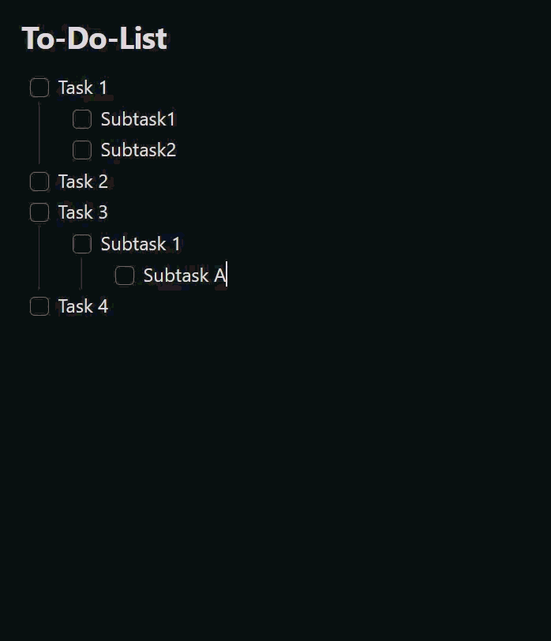

# Smart Done Mover

一款 [Obsidian](https://obsidian.md) 插件，用于将已完成的复选框任务（包括缩进的子任务）移动到同一篇笔记中可自定义的完成区。

🌍 **语言：** [English](README.md) · [Deutsch](README.de.md) · 简体中文（本页）

插件界面会跟随 Obsidian 的语言：默认英文；Obsidian 使用德语时显示德语；使用中文时显示简体中文。

## 演示



## 功能

- 编辑器**右键菜单**：
  - *将已完成任务移至完成区*：移动所有符合完成条件的任务。
  - *将选中任务移至完成区*：移动与当前文字选区相交的任务块；仅在有文字选区时显示。
- 两个操作也可通过**命令面板**执行，并可绑定快捷键。
- **自动模式**（可选）：任务勾选后自动移动。它也会检测 [Tasks](https://publish.obsidian.md/tasks/) 插件勾选任务后写回源笔记的变化；为避免频繁触发，会在短暂防抖后处理（至少约 400 ms）。
- **任务筛选**（可选）：例如填写 `#task`，则自动模式、*将已完成任务移至完成区* 与 *将选中任务移至完成区* 都只处理包含该文本的任务。
  - 留空时恢复原有行为：所有父任务及其标准复选框子任务都完成后，整个任务块可以移动。
  - 带筛选文本的任务必须已勾选；若其后代中还有带筛选文本的任务，这些后代也必须已勾选。未带筛选文本的后代不会阻止移动。
  - 带筛选文本的父任务移动时，会带走完整的缩进块，包括普通备注和未带筛选文本的子复选框。父任务未带筛选文本、子任务带筛选文本时，该子任务会连同它自己的缩进块单独移动。
- **排除的文件夹/文件**（可选）：自动模式不会在配置的库内路径（包括子文件夹）中运行；手动命令仍可使用。
- 可选择为每个已移动且已勾选的任务追加完成日期 `✅ YYYY-MM-DD`，且不会重复添加。
- 完成区标题可自由定义：输入普通文字仍沿用 `### Done` 的兼容行为；输入完整 Markdown 标题，如 `# 已完成`，即可指定标题层级。已有同名标题会被复用。

## 设置

| 设置项 | 说明 | 默认值 |
|---|---|---|
| 自动模式 | 勾选任务后自动移动符合条件的已完成任务 | 关闭 |
| 完成区标题 | 目标完成区标题；普通文字创建 `###` 标题，完整 Markdown 标题保留其层级 | `Done` |
| 任务筛选 | 任务必须包含的文本；留空则不筛选 | 空 |
| 添加完成日期 | 为每个已移动且已勾选的任务添加 `✅ YYYY-MM-DD` | 开启 |
| 排除的文件夹/文件 | 每行一个库内路径；自动模式不会在其中运行 | 空 |

## 使用方法

1. 打开包含复选框任务列表的笔记。
2. 如只希望移动特定任务，在**任务筛选**中填写例如 `#task` 的文本。
3. 在编辑器中右键选择操作、通过命令面板执行对应命令，或开启**自动模式**。
4. 符合条件的任务会被移动到配置的完成区标题下。

## 数据与隐私

- 插件完全离线运行，**不会发起网络请求**。
- 不收集遥测数据，也不会在你的库之外保存数据。
- 无论手动还是自动移动，插件只修改触发移动的那一篇笔记，不会修改其他笔记。
- 设置保存在库配置目录中插件对应的 `data.json` 文件内。
- 不需要账号、付费或外部服务。

## 从源码构建

```bash
npm ci
npm test          # Vitest 单元测试
npm run build     # 生成 main.js
```

## 安装到 Obsidian 库

普通安装时，请从对应版本的 GitHub Release 下载 `main.js` 和 `manifest.json`，复制到：

```text
<你的库>/.obsidian/plugins/smart-done-mover/
```

随后在 Obsidian 的 **设置 → 第三方插件** 中启用插件。

开发时也可以直接将项目文件夹用作插件目录，并运行 `npm run dev` 进行监听构建。

## 发布

推送 Git 标签会触发 `.github/workflows/release.yml`：自动安装依赖、运行测试、构建，并将 `main.js` 和 `manifest.json` 附加到新的 GitHub Release。标签必须与 `manifest.json` 中的 `version` 一致。

## 项目结构

| 文件 | 作用 |
|---|---|
| `main.ts` | 插件入口：命令、右键菜单、自动模式与 Tasks 写回检测 |
| `src/taskParser.ts` | Markdown 解析、完成区和任务块识别 |
| `src/mover.ts` | 纯任务移动逻辑 |
| `src/settings.ts` | 设置界面 |
| `src/exclusions.ts` | 自动模式的路径排除判断 |
| `src/i18n.ts` | 英文、德文、简体中文界面文字 |
| `src/types.ts` | 共享类型与默认设置 |
| `src/*.test.ts` | 单元测试 |

`taskParser.ts`、`mover.ts` 和 `exclusions.ts` 不依赖 Obsidian，因此可以在不启动 Obsidian 的情况下进行单元测试。

## 项目来源

Smart Done Mover 是一个独立维护的项目，基于 DonnervS 的 [To-Do to Done Mover](https://github.com/DonnervS/obsidian-todo-done-mover) 演化而来，并保留原项目的 MIT 许可证。

## 许可证

[MIT](LICENSE)
